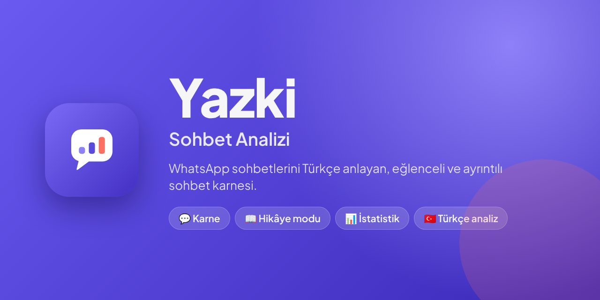
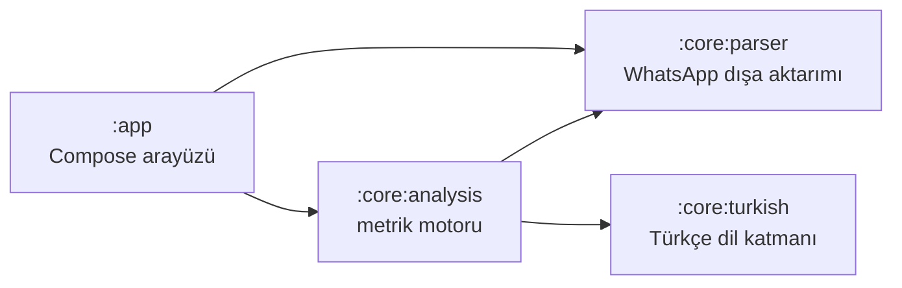

<p align="center">
  
</p>

<p align="center">
  
  
  
  
</p>

<p align="center">
  <b>WhatsApp sohbetlerini Türkçe anlayan, eğlenceli ve ayrıntılı sohbet karnesi.</b><br>
  Kim daha çok yazıyor, kim önce günaydın diyor, kim kaç dakikada cevap veriyor?<br>
  Sohbetini dışa aktar, Yazki gerisini hesaplasın.
</p>

---

## Neden Yazki?

Sohbet analizi yapan uygulamaların çoğu İngilizce düşünür: "haha"yı tanır ama "sjsjsj"yi tanımaz,
"knk"nın bir hitap olduğunu bilmez, "günaydınnnn"ı ayrı bir kelime sayar. Yazki baştan Türkçe
sohbetler için tasarlandı.

- **Türkçe dil katmanı.** `ı/i` ayrımına saygılı küçük harfe çevirme, ASCII katlama (`ş → s`),
  uzatılmış yazımları tanıma (`sevgilimmm`, `iyi gecelerrr`), Türkçe kahkahalar (`sjsj`, `ksksk`, `hahaha`).
- **Hitaplar ve selamlaşmalar.** knk, kanka, aşkım, hocam, abi… Günaydın, iyi geceler, hayırlı cumalar,
  nasılsın, teşekkürler, tamam, özür dilerim; hepsi kişi başına sayılır.
- **Sohbet türüne göre karne.** Arkadaş, Arkadaş Grubu, Sevgili & Flört, Aile, İş & Okul. Analiz aynıdır;
  tür yalnızca hangi kartların anlamlı olduğunu belirler. İş grubunda "En romantik" kartı çıkmaz.
- **Gizlilik tasarımın parçası.** Uygulamanın internet izni yoktur. Mesaj metni hiçbir yere yazılmaz,
  kayıtlı sohbetlerde yalnızca hesaplanmış istatistikler tutulur.

## Özellikler

| | |
|---|---|
| 📋 **Karne** | Sohbetin öne çıkanları: en çok yazan, en hızlı cevap veren, sohbeti en çok başlatan, gece kuşu, en uzun sessizlik… |
| 📖 **Hikâye modu** | Karneyi tam ekran, otomatik ilerleyen sayfalar halinde izleme |
| 📊 **İstatistik** | Saat ve gün dağılımı, aylık grafik, kişi başına sayaçlar, en sık kelimeler ve emojiler |
| 🗂️ **Kayıtlı sohbetler** | Analizler cihazda saklanır; aynı sohbet tekrar aktarılırsa kayıt güncellenir |
| 📥 **Kolay içe aktarma** | WhatsApp'ın "Sohbeti dışa aktar" menüsünden doğrudan paylaşım ya da dosya seçici (.txt / .zip) |
| 🌗 **Açık ve koyu tema** | İlk açılışta telefonun temasını izler, sonra Ayarlar'dan seçilir |

<!--
## Ekran görüntüleri

<p align="center">
  
  
  
  
</p>
-->

## Mimari

Proje dört Gradle modülünden oluşur. Ayrıştırma, Türkçe dil işleme ve analiz **saf Kotlin**dir;
Android'e bağımlı değildir ve testleri emülatör açmadan saniyeler içinde çalışır.



| Modül | Sorumluluk |
|---|---|
| `:core:parser` | `.txt` / `.zip` dışa aktarımını mesajlara ayırır. Android ve iOS biçimi, Türkçe ve İngilizce telefon dili, gün/ay sırası dosyanın tamamından tespit edilir. Sistem mesajları ve medya satırları ayrı sınıflanır. |
| `:core:turkish` | Türkçe küçük harf ve katlama, uzatma sıkıştırma, kahkaha tespiti, hitaplar, selamlaşma/nezaket sayaçları, dolgu kelimeleri. Her mesaj bir kez bölünür (`TokenizedText`), bütün sayaçlar aynı listeyi paylaşır. |
| `:core:analysis` | Hacim, zaman, etkileşim, cevap süresi, sohbet başlatma, çift mesaj, hayalet, emoji ve grup ödülleri. Tek geçişte çalışır. |
| `:app` | Jetpack Compose + Material 3 arayüzü, paylaş menüsü entegrasyonu, kayıt deposu, tema ve tanıtım ekranları. |

### Teknoloji

| | |
|---|---|
| Dil | Kotlin 2.4 (JVM 17 hedefi) |
| Arayüz | Jetpack Compose (BOM 2026.09), Material 3, Plus Jakarta Sans |
| Durum | `ViewModel` + `StateFlow`, Kotlin Coroutines |
| Depolama | Uygulamanın özel klasöründe JSON (`AtomicFile`), ayarlar için `SharedPreferences` |
| Derleme | Gradle 9.6, Android Gradle Plugin 9.4, sürüm kataloğu (`gradle/libs.versions.toml`) |
| Uyumluluk | minSdk 24, `java.time` için core library desugaring, target/compileSdk 37 |

### Klasör yapısı

```
yazki/
├── app/                      Android uygulaması
│   └── src/main/java/com/hamzabilici/yazki/
│       ├── data/             içe aktarma, kayıt deposu, JSON kodlayıcı
│       └── ui/               ekranlar, bileşenler, tema, hikâye, tanıtım
├── core/
│   ├── parser/               WhatsApp dışa aktarım ayrıştırıcı
│   ├── turkish/              Türkçe dil katmanı
│   └── analysis/             metrik motoru
├── design/                   logo kaynağı (SVG) ve görseller
└── gradle/                   sürüm kataloğu ve wrapper
```

## Ölçümler nasıl hesaplanır?

Eşikler `AnalysisConfig` içinde tek yerde durur.

| Ölçüm | Tanım |
|---|---|
| Sohbet başlatma | En az **3 saat** sessizlikten sonra gelen ilk mesaj (ne yazıldığı fark etmez) |
| Cevap süresi | Konuşan kişi değiştiğinde geçen süre, **medyan** olarak. 6 saatten uzun aralar sayılmaz |
| Çift mesaj | Cevap gelmeden **10 dakika** sonra tekrar yazmak |
| Hayalet | Mesaja **24 saat** içinde cevap gelmemesi |
| Gece mesajı | 00:00–04:59 arası |

Android dışa aktarımında saniye bulunmaz; bu durumda 1 dakikanın altındaki cevaplar
"1 dk içinde" olarak gösterilir, yanıltıcı "0 sn" çıkmaz.

**Performans:** masaüstü JVM'de 200.000 mesajlık bir sohbet ~0,7 sn'de ayrıştırılır ve ~0,7 sn'de analiz edilir.
Sıcak yollarda regex yerine elle yazılmış taramalar kullanılır.

## Gizlilik

- Manifest'te **`INTERNET` izni yoktur**. `AppContextTest.noInternetPermission` bunu cihaz testinde denetler;
  yeni bir bağımlılık eklerken Merged Manifest kontrol edilmelidir.
- Yedekleme kapalıdır (`allowBackup="false"` ve bütün alanları dışlayan kurallar).
- Ham mesaj metni saklanmaz. Kayıtlı sohbetlerde yalnızca hesaplanmış sayılar tutulur.
- `.gitignore`, gerçek sohbet dosyalarının (`*.txt`, `*.zip`) depoya girmesini engeller.
  Testlerde yalnızca uydurma örnek sohbetler kullanılır.

## Derleme ve çalıştırma

**Gereksinimler:** güncel Android Studio, JDK 17 veya üstü, Android SDK 37.

```bash
git clone https://github.com/<kullanici-adi>/yazki.git
cd yazki

# hata ayıklama sürümünü bağlı cihaza / emülatöre kur
./gradlew :app:installDebug

# saf Kotlin modüllerinin testleri (emülatör gerekmez)
./gradlew :core:parser:test :core:turkish:test :core:analysis:test

# uygulama birim testleri
./gradlew :app:testDebugUnitTest
```

Windows'ta `./gradlew` yerine `gradlew` yazın. Android Studio'da projeyi açıp **Run** demek de yeterlidir.

### Denemek için sohbet nasıl aktarılır?

1. WhatsApp'ta sohbeti açın → **⋮ → Diğer → Sohbeti dışa aktar** (iOS: kişi adı → **Sohbeti Dışa Aktar**).
2. **Medya olmadan** seçin.
3. Paylaş menüsünden **Yazki**'yi seçin ya da dosyayı kaydedip uygulamada **Sohbet seç**'e dokunun.

## Yol haritası

- [ ] Hikâye sayfalarını 9:16 paylaşım kartı olarak dışa aktarma
- [ ] Hafif Türkçe kök bulma
- [ ] Çok büyük dosyalarda yüzdeli ilerleme göstergesi
- [ ] İlgi dengesi, imza kelime (TF-IDF) ve lakap tespiti

## Notlar

Sonuçlar eğlence amaçlıdır.

Yazki bağımsız bir projedir; WhatsApp veya Meta ile bir bağlantısı yoktur. "WhatsApp" adı yalnızca
desteklenen dosya biçimini belirtmek için kullanılır.

Yazı tipi: [Plus Jakarta Sans](https://github.com/tokotype/PlusJakartaSans), SIL Open Font License 1.1
(`app/src/main/assets/licenses`).
